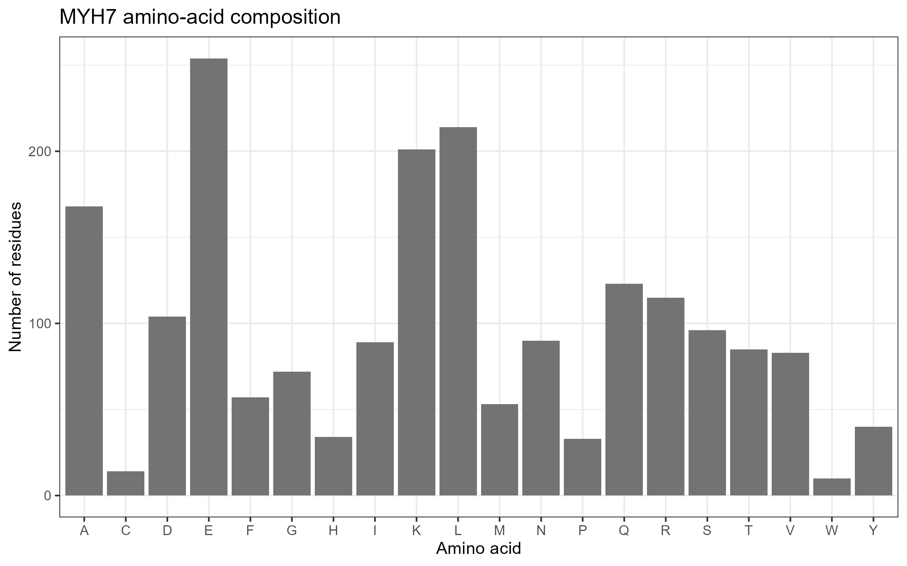

# Molecular Mechanisms of Muscle Contractility
## Protein Structure and Mutation Analysis: MYH7

**Student Name:** Deguit, Zenas Charis C.  
**Course:** Cell and Molecular Biology  
**Assignment Number:** 07  
**Organism:** Homo sapiens  
**Gene:** MYH7  
**Reference Transcript:** NM_000257.4  
**Reference Protein:** NP_000248.2  
**ClinVar Variation ID:** 42875  
**Variant:** NM_000257.4:c.1988G>A (p.Arg663His)  
**Variant Type:** Missense  
**Software:** RStudio, NCBI, ClinVar, UniProt, GitHub  

---

## 1. Introduction

Muscle contraction occurs through interactions between actin and myosin filaments. Myosin uses energy from ATP hydrolysis to produce the force needed for muscle movement. Changes in genes encoding contractile proteins may affect how muscles generate force.

This laboratory activity focuses on the MYH7 gene, which encodes beta-myosin heavy chain. The activity examines its protein sequence, amino-acid composition, and an assigned missense variant associated with hypertrophic cardiomyopathy.

## 2. Research Question

How does the MYH7 p.Arg663His missense variant potentially affect beta-myosin heavy chain function and cardiac muscle contraction?

## 3. Objectives

1. Retrieve the human MYH7 gene record and matching protein sequence from NCBI using RStudio.
2. Determine protein length and amino-acid composition.
3. Generate an amino-acid composition graph and a protein-position plot.
4. Examine the assigned ClinVar variant and its clinical classification.
5. Explain the possible molecular consequences of the variant.
6. Propose an experiment to investigate its effect on muscle contraction.

## 4. Methodology

### Step 1. RStudio Setup

A working folder named `Muscle_Contractility_MYH7` was created. The required packages were installed and loaded.

```r
install.packages(c("rentrez", "ggplot2"))

library(rentrez)
library(ggplot2)

gene_symbol <- "MYH7"
transcript_accession <- "NM_000257.4"
clinvar_id <- "42875"
variant_protein <- "p.Arg663His"

for (x in c("data", "results", "figures")) {
  dir.create(x, showWarnings = FALSE)
}
```

### Step 2. NCBI Gene Retrieval

The human MYH7 gene record was retrieved using the `entrez_search()` and `entrez_summary()` functions from the rentrez package.

The exact gene symbol was verified, and the results were saved as `results/gene_summary.txt`.

### Step 3. Protein Sequence Retrieval

The assigned transcript `NM_000257.4` was retrieved from NCBI Nucleotide using `entrez_fetch()`.

The matching RefSeq protein accession `NP_000248.2` was extracted from the GenBank record. Its FASTA sequence was downloaded and saved as `data/MYH7_protein.fasta`.

### Step 4. Amino-Acid Composition Analysis

The protein FASTA sequence was read using `readLines()`. The amino acids were counted using `table()`, and the results were saved in `results/amino_acid_composition.csv`.

A bar graph was generated using `ggplot2` and saved as `figures/01_amino_acid_composition.png`.

### Step 5. ClinVar Variant Analysis

The assigned ClinVar Variation ID 42875 was examined to identify the nucleotide change, protein substitution, clinical classification, associated condition, and review status.

### Step 6. Protein-Position Visualization

A linear protein map was created using `ggplot2`. The position of the p.Arg663His variant was marked at amino acid 663 of the reference MYH7 protein.

The graph was saved as `figures/02_variant_position.png`.

## 5. Results

### 5.1 Gene and Protein Information

| Parameter | Result |
|---|---|
| Gene Symbol | MYH7 |
| Official Gene Name | Myosin heavy chain 7 |
| NCBI Gene ID | 4625 |
| Chromosome | 14 |
| Reference Transcript | NM_000257.4 |
| Protein Accession | NP_000248.2 |
| Protein Length | 1,935 amino acids |
| Protein Function | ATP-dependent actin-based motor protein |

MYH7 encodes beta-myosin heavy chain, a protein involved in force generation during muscle contraction. It forms part of the thick filaments within muscle sarcomeres.

### 5.2 Amino-Acid Composition



**Figure 1. MYH7 amino-acid composition.** The bar graph shows the frequency of the 20 standard amino acids in the 1,935-amino-acid MYH7 protein. Glutamic acid (E), lysine (K), and leucine (L) were the most abundant amino acids, based on the generated graph. This illustrates the protein's amino-acid distribution but does not directly establish its biological function.

The exact frequencies are recorded in `results/amino_acid_composition.csv`.

### 5.3 ClinVar Variant Information

| Parameter | Result |
|---|---|
| Gene | MYH7 |
| Variation ID | 42875 |
| Transcript | NM_000257.4 |
| Nucleotide Change | c.1988G>A |
| Protein Change | p.Arg663His |
| Mutation Type | Missense |
| Clinical Classification | Pathogenic |
| Associated Condition | Hypertrophic cardiomyopathy |
| Review Status | 3 stars — reviewed by expert panel |
| Last Submission | October 3, 2026 |

The variant involves the substitution of arginine (Arg) with histidine (His) at amino acid position 663. This is a missense mutation because one amino acid is replaced without changing the overall length of the reference protein.

### 5.4 MYH7 Protein-Position Plot


**Figure 2. Position of the p.Arg663His variant in MYH7.** The horizontal line represents the 1,935-amino-acid reference protein. The black marker indicates the position of the missense variant at residue 663. This figure identifies the mutation's sequence location but does not demonstrate its functional effect.

## 6. Molecular Mechanism

### Normal MYH7 Function

MYH7 encodes beta-myosin heavy chain, an important motor protein in cardiac muscle. It interacts with actin filaments and hydrolyzes ATP to generate mechanical force. This activity contributes to the sliding-filament mechanism responsible for muscle contraction.

### Assigned Variant

The c.1988G>A nucleotide substitution produces the p.Arg663His amino-acid change. The variant occurs within the myosin head region, which is important for motor activity.

ClinVar classifies this variant as pathogenic for hypertrophic cardiomyopathy. Clinical evidence supports its association with disease, although the exact molecular effects must be interpreted using experimental findings rather than sequence information alone.

### Causal Chain

MYH7 gene  
↓  
Beta-myosin heavy chain protein  
↓  
ATP-dependent interaction with actin  
↓  
Generation of force during cardiac muscle contraction  
↓  
p.Arg663His missense substitution  
↓  
Possible alteration in myosin motor function  
↓  
Potential disturbance of cardiac muscle contraction

### Proposed Experiment

An ATPase activity assay could compare normal MYH7 protein with the p.Arg663His variant. Measuring ATP hydrolysis under the same conditions would help determine whether the substitution changes myosin enzymatic activity.

A force-generation assay could provide additional information about the mutation's effect on muscle contraction.

## 7. Discussion

The MYH7 gene encodes beta-myosin heavy chain, a motor protein that plays an important role in cardiac muscle contraction. Myosin interacts with actin and uses energy from ATP hydrolysis to generate force. This process allows muscle filaments to slide past one another, producing contraction. Because MYH7 is directly involved in force generation, changes in its protein structure may influence normal cardiac muscle function.

The RStudio analysis identified the matching reference protein accession as NP_000248.2, containing 1,935 amino acids. The amino-acid composition graph showed that glutamic acid, lysine, and leucine were among the most abundant residues. These results describe the protein's composition, but amino-acid frequency alone cannot determine its three-dimensional structure, enzymatic activity, or the effects of a mutation. Additional structural and experimental evidence is necessary to understand these properties.

The assigned variant, NM_000257.4:c.1988G>A (p.Arg663His), is a missense mutation that replaces arginine with histidine at amino acid position 663. ClinVar classifies this variant as pathogenic for hypertrophic cardiomyopathy, with a three-star expert-panel review status. The classification is supported by clinical observations, including reports of affected individuals and segregation of the variant with disease in families. This provides strong evidence for its clinical significance.

The variant occurs within the myosin head region, which contributes to motor activity. Since arginine and histidine have different chemical properties, the substitution may influence local protein interactions or motor function. However, the protein-position graph only identifies the location of the mutation. It cannot establish whether the substitution directly changes ATPase activity, force production, or the rate of muscle contraction.

Clinical association, computational prediction, and experimental evidence must therefore be distinguished. Clinical observations support the relationship between p.Arg663His and hypertrophic cardiomyopathy, while computational approaches can suggest possible structural or functional changes. Published experimental findings have also reported abnormal calcium handling and cellular activity associated with this variant, but these observations do not establish every step of the molecular mechanism.

To investigate the proposed effect, an ATPase activity assay could compare normal and mutant MYH7 proteins. Additional measurements of contractile force and calcium signaling could help determine how the variant influences cardiac muscle function. Overall, the findings demonstrate the importance of combining sequence analysis, clinical evidence, and experimental testing when interpreting disease-associated mutations.

## 8. Questions and Answers

### 1. What does your assigned gene encode, and how does this protein contribute to muscle function?

MYH7 encodes beta-myosin heavy chain, a motor protein involved in cardiac muscle contraction. It interacts with actin and uses ATP to generate mechanical force, allowing muscle fibers to contract.

### 2. What was the exact protein accession and length retrieved with R?

The protein accession retrieved from the assigned transcript was NP_000248.2, with a total length of 1,935 amino acids.

### 3. What did the amino-acid composition chart show? What can it NOT tell you?

The chart showed the frequencies of the 20 standard amino acids in MYH7, with glutamic acid, lysine, and leucine appearing most frequently. However, amino-acid composition alone cannot determine protein structure, function, or the effect of a specific mutation.

### 4. What is your fixed ClinVar variant, and what is its current classification and evidence strength?

The assigned variant is NM_000257.4:c.1988G>A (p.Arg663His), ClinVar Variation ID 42875. It is classified as pathogenic for hypertrophic cardiomyopathy and has a three-star review status, indicating evaluation by an expert panel.

### 5. What is the scientifically supported mechanism linking this variant to muscle function, and what remains uncertain?

The variant changes arginine to histidine at position 663 within the MYH7 myosin head region. This region contributes to myosin motor function, and the substitution may influence cardiac contraction. However, the exact changes in ATPase activity and force generation cannot be concluded from the sequence and position plot alone.

### 6. What additional experiment would help test the proposed mechanism?

An ATPase activity assay comparing normal MYH7 and the p.Arg663His variant could help determine whether the mutation changes ATP hydrolysis. A force-generation assay could also test whether the variant alters muscle contractility.

## 9. Limitations

This activity relied mainly on database records and computational sequence analysis. The amino-acid composition and protein-position plots describe sequence properties but do not directly measure protein activity.

The ClinVar classification supports the clinical significance of p.Arg663His, but the analyses performed in this laboratory cannot independently confirm its pathogenicity or establish the exact molecular mechanism.

Further experimental testing is needed to determine its effects on ATPase activity, actin interactions, force generation, and calcium signaling.

## 10. Conclusion

This laboratory activity successfully retrieved and analyzed the human MYH7 gene and its corresponding reference protein using RStudio and NCBI. The reference protein NP_000248.2 contained 1,935 amino acids, and its amino-acid composition was visualized using a bar graph.

The assigned p.Arg663His missense variant was identified at position 663 and is classified as pathogenic for hypertrophic cardiomyopathy in ClinVar. The findings demonstrate how genetic variation in a contractile protein may be associated with altered cardiac muscle function.

However, the sequence analysis and protein-position plot cannot directly establish the variant's molecular effects. Additional experiments, such as ATPase and force-generation assays, would help clarify how the mutation influences muscle contraction.

## 11. Reproducibility

The analysis can be reproduced using RStudio and an internet connection.

### Requirements

- R and RStudio
- rentrez package
- ggplot2 package
- Internet access for NCBI retrieval

### Instructions

1. Download or clone this GitHub repository.
2. Open RStudio.
3. Set the working directory to the downloaded repository folder.
4. Open `analysis.R`.
5. Install the required packages if they are not already installed:

```r
install.packages(c("rentrez", "ggplot2"))
```

6. Run the entire `analysis.R` script.
7. Check the `data`, `results`, and `figures` folders for the generated outputs.
8. Compare the retrieved accession, protein length, and variant position with the reported results.

The script uses the assigned gene MYH7, transcript NM_000257.4, and ClinVar Variation ID 42875.

No errors requiring changes to the assigned gene or variant were encountered during the completed analysis.

## 12. Repository Contents

```text
Muscle-Contractility-MYH7/
|
|-- README.md
|-- analysis.R
|
|-- data/
|   |-- MYH7_protein.fasta
|
|-- results/
|   |-- gene_summary.txt
|   |-- protein_accession.txt
|   |-- amino_acid_composition.csv
|
|-- figures/
    |-- 01_amino_acid_composition.png
    |-- 02_variant_position.png
```

## 13. References

1. National Center for Biotechnology Information (NCBI). MYH7 Gene, Homo sapiens. Gene ID: 4625. https://www.ncbi.nlm.nih.gov/gene/4625

2. NCBI RefSeq. MYH7 reference transcript NM_000257.4. https://www.ncbi.nlm.nih.gov/nuccore/NM_000257.4

3. NCBI RefSeq. MYH7 reference protein NP_000248.2. https://www.ncbi.nlm.nih.gov/protein/NP_000248.2

4. NCBI ClinVar. MYH7 c.1988G>A (p.Arg663His), Variation ID 42875. https://www.ncbi.nlm.nih.gov/clinvar/variation/42875/

5. ClinGen Cardiomyopathy Variant Curation Expert Panel. MYH7 p.Arg663His variant classification and supporting evidence. https://erepo.clinicalgenome.org/evrepo/ui/classification/b27a29bf-ad68-4066-b07a-e5dcac3e6944?version=1.1

6. UniProt Consortium. MYH7_HUMAN, Myosin-7, UniProtKB P12883. https://www.uniprot.org/uniprotkb/P12883/entry

7. Lan, F., et al. (2013). Abnormal calcium handling properties underlie familial hypertrophic cardiomyopathy pathology in patient-specific induced pluripotent stem cells. Cell Stem Cell, 12(1), 101–113. https://pubmed.ncbi.nlm.nih.gov/23290139/

8. RCSB Protein Data Bank. https://www.rcsb.org/
